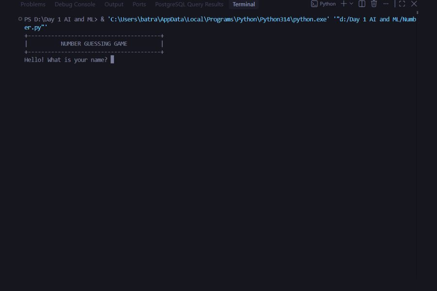
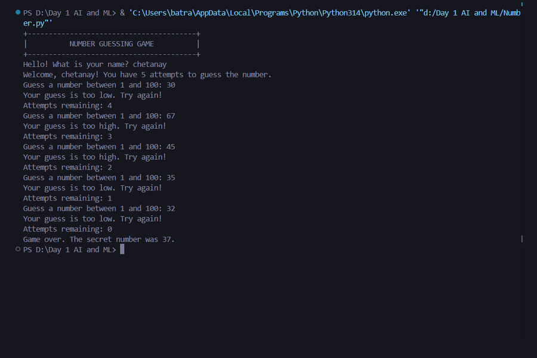

<div align="center">

# Number Guessing Game 🎯

> **A focused command-line project exploring input validation, game state, and control flow in Python.**


</div>

---

## 🧭 Overview

The Number Guessing Game selects a secret integer between 1 and 100 and gives the player five valid guesses. It validates numeric input and range, compares each accepted guess with the secret, and reports whether the guess is too high, too low, or correct. A correct guess is acknowledged, but the current round continues until all five valid guesses have been entered.

The project is implemented in one Python file and uses only the standard library.

## 🏗️ System Architecture

```text
[ Player Input ]
       │
       ▼
[ Input Validation ] ──> Reject non-integers and values outside 1–100
       │
       ▼
[ Game State ] ─────────> Secret number + remaining-attempt counter
       │
       ▼
[ Guess Evaluation ] ───> Compare guess and provide feedback
       │
       ▼
[ Terminal Output ] ────> Show remaining attempts and reveal the secret
```

The `__main__` guard starts the greeting and game when `Number.py` is run directly. `greet_user()` handles the welcome prompt; `play_game()` owns the secret number, attempt counter, and guess history for a round.

## 📂 Project Structure

```text
Day-01-Number-guessing-game/
├── Number.py                       # Game logic and command-line interface
├── README.md                       # Project documentation
└── assets/
    ├── banner.svg                  # Project banner
    ├── terminal-start.png          # Terminal startup screenshot
    ├── terminal-start-preview.png  # Startup preview
    ├── terminal-gameplay.png       # Gameplay screenshot
    └── terminal-gameplay-preview.png
```

## 🚀 Quick Start

### Prerequisites

- Python 3.6 or newer
- No third-party packages

### Run

From this directory, execute:

```bash
python Number.py
```

On Windows, `py Number.py` is also supported when the Python launcher is installed.

## 💻 Core Implementation

The game accepts only whole-number guesses in the supported range. Invalid input does not consume an attempt.

```python
try:
    guess = int(input("Guess a number between 1 and 100: "))
except ValueError:
    print("Please enter a whole number.")
    continue

if not 1 <= guess <= 100:
    print("Please enter a number between 1 and 100.")
    continue

if guess == secret_no:
    print(f"Congratulations! You guessed {secret_no} correctly!")
elif guess < secret_no:
    print("Your guess is too low. Try again!")
else:
    print("Your guess is too high. Try again!")
```

## 💡 Engineering Takeaways

- **Input validation:** Convert user input explicitly and handle conversion errors with a targeted `ValueError` handler.
- **State ownership:** Keep the secret number, attempt count, and guess history local to the game function.
- **Control flow:** Use a loop and conditional branches to manage attempts and compare values.
- **Standard-library randomness:** Generate the secret integer with `random.randint()`.

## 🖼️ Screenshots

<p align="center">
  
  
</p>

---

**Author:** [chetanaybuilder](https://github.com/chetanaybuilder) · Future Founder
