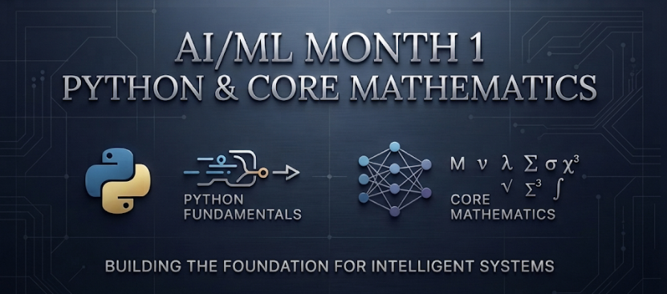
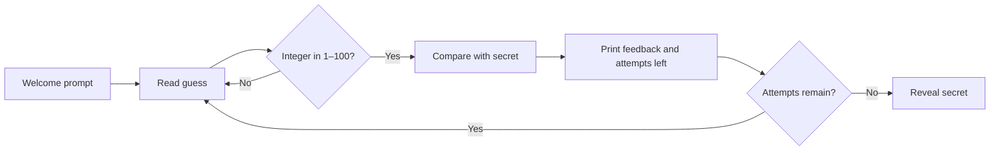

<p align="center">
  
</p>

<h1 align="center">Number Guessing Game</h1>

<p align="center">
  A focused command-line exercise in input validation, game state, and Python control flow.
</p>

<p align="center">
  
  
  
</p>

<p align="center">
  <a href="#overview">Overview</a> ·
  <a href="#what-i-learned">Learning</a> ·
  <a href="#setup-and-run">Run</a> ·
  <a href="#engineering-takeaways">Takeaways</a>
</p>

---

## Overview

The program selects a secret integer from **1 to 100** and gives the player **five valid guesses**. After each accepted guess, it reports whether the value is too low, too high, or correct. It is implemented in one Python file and uses no third-party packages.

## What I Learned

### Learning Progress

**Day 01 — Python Fundamentals**

This first project in Month 01 applies foundational program flow: functions, integer conversion, comparisons, loops, and conditional branches. It does not cover every Python fundamental (such as collections or data modeling); its focus is the interaction loop.

### What I Built

I implemented a terminal game in [`Number.py`](Number.py) that:

- Welcomes a player by name.
- Generates a random number with `random.randint(1, 100)`.
- Accepts whole-number guesses, rejects invalid input, and keeps a count of valid attempts.
- Gives high/low/correct feedback and reveals the secret number after the attempt limit.

`greet_user()` handles the welcome prompt; `play_game()` owns the state for a round. A correct guess is acknowledged, but the current implementation does not end the round early.

### Engineering Takeaways

1. Convert and validate external input before using it.
2. Keep round-specific state local to the function that manages the round.
3. Use `continue` to reject invalid input without consuming an attempt.
4. Make the attempt limit and accepted range explicit in program logic.

## Features

| Capability | Behavior |
|---|---|
| Random target | Inclusive range from 1 through 100 |
| Attempt limit | Five valid guesses |
| Input validation | Non-integers and values outside the range are rejected |
| Feedback | Reports low, high, or correct after each valid guess |
| Dependencies | Python standard library only |

## Architecture



## Project Structure

```text
Day-01-Number-guessing-game/
├── Number.py
└── README.md
```

## Setup and Run

Requirements: Python 3.6 or later. No virtual environment or package installation is required.

Run from this project directory:

```console
python Number.py
```

On Windows, `py Number.py` also works if the Python launcher is installed.

## Interaction

Enter a name, then submit whole-number guesses between 1 and 100. Invalid input is rejected without using one of the five valid attempts. The secret number is randomly selected at each program start, so an exact transcript is not deterministic.

## Error Handling and Limitations

Input conversion handles `ValueError`, and the range check prevents guesses outside the game bounds. The `history` list records accepted guesses but is not currently displayed or used. The game also continues after a correct guess until all five valid attempts are used.

## Testing

No automated test files are included in this project.

## Future Improvements

- Stop the round on a correct guess.
- Add unit tests by isolating the round logic and injecting the secret number.
- Display the recorded guess history or remove the unused collection.

## Project Information

Part of the **AI/ML Month 1 — Python and Core Mathematics** learning series.

Author: [chetanaybuilder](https://github.com/chetanaybuilder)
