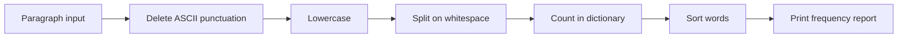

<p align="center">
  
</p>

<h1 align="center">Word Frequency Analyzer</h1>

<p align="center">
  A compact text-processing pipeline for normalizing a paragraph and counting its words.
</p>

<p align="center">
  
  
  
</p>

<p align="center">
  <a href="#overview">Overview</a> ·
  <a href="#what-i-learned">Learning</a> ·
  <a href="#setup-and-run">Run</a> ·
  <a href="#engineering-takeaways">Takeaways</a>
</p>

---

## Overview

The analyzer reads a paragraph from standard input, removes ASCII punctuation, converts text to lowercase, and splits it on whitespace. It prints each word's frequency in alphabetical order, then reports total and unique word counts.

## What I Learned

### Learning Progress

**Day 02 — Strings, Normalization, and Dictionaries**

This project builds on basic Python execution by introducing a small data-processing pipeline: transform a string, tokenize it, aggregate repeated values, and format a report.

### What I Built

I implemented [`text_analyzer.py`](text_analyzer.py), a single-script analyzer that:

- Reads one paragraph with `input()`.
- Removes characters listed in `string.punctuation` and lowercases the text.
- Splits the normalized string into whitespace-delimited tokens.
- Counts words in a dictionary and prints the counts alphabetically.

The total count is the number of tokens after normalization; the unique count is the number of dictionary keys.

### Engineering Takeaways

1. Normalize data consistently before comparing or aggregating it.
2. A dictionary provides a direct representation for word-to-count mappings.
3. Sorting at presentation time gives deterministic, readable output.
4. Tokenization and punctuation policies affect the meaning of the result.

## Features

| Stage | Implementation |
|---|---|
| Input | One paragraph from the terminal |
| Normalization | Delete ASCII punctuation; lowercase |
| Tokenization | Whitespace splitting |
| Aggregation | Dictionary counts |
| Report | Alphabetical frequencies, total tokens, unique tokens |

## Architecture



## Project Structure

```text
Day-02-Word-Frequency-Analyzer/
├── text_analyzer.py
└── README.md
```

## Setup and Run

Requirements: Python 3.6 or later. No virtual environment or package installation is required.

Run from this project directory:

```console
python text_analyzer.py
```

On Windows, `py text_analyzer.py` also works if the Python launcher is installed.

## Example

Input:

```text
Python is useful. Python is readable.
```

Output:

```text
is: 2
python: 2
readable: 1
useful: 1
Total words: 6
Unique words: 4
```

## Error Handling and Limitations

There is no custom input error handling. Punctuation handling uses Python's ASCII `string.punctuation`, not a Unicode-aware tokenizer. Punctuation is deleted rather than replaced with whitespace, so `well-known` becomes `wellknown`. Empty input produces zero tokens and zero unique words.

## Testing

No automated test files are included in this project.

## Future Improvements

- Extract normalization and counting into a function that can be unit tested.
- Define Unicode punctuation and tokenization behavior explicitly.
- Support reading text from a file in addition to terminal input.

## Project Information

Part of the **AI/ML Month 1 — Python and Core Mathematics** learning series.

Author: [chetanaybuilder](https://github.com/chetanaybuilder)
