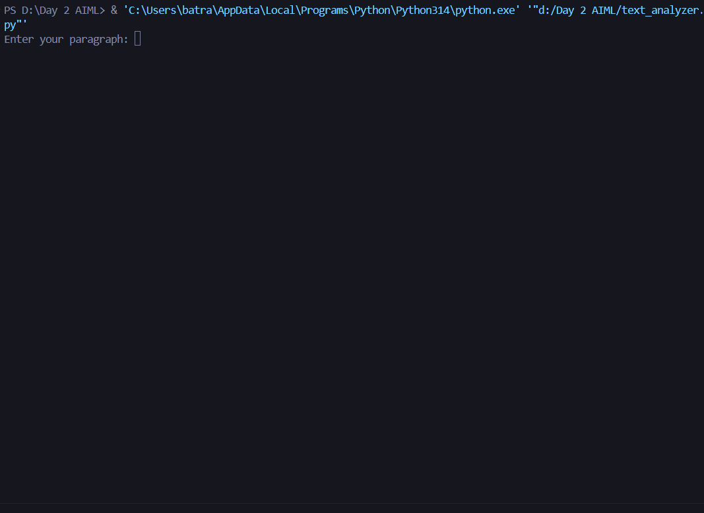
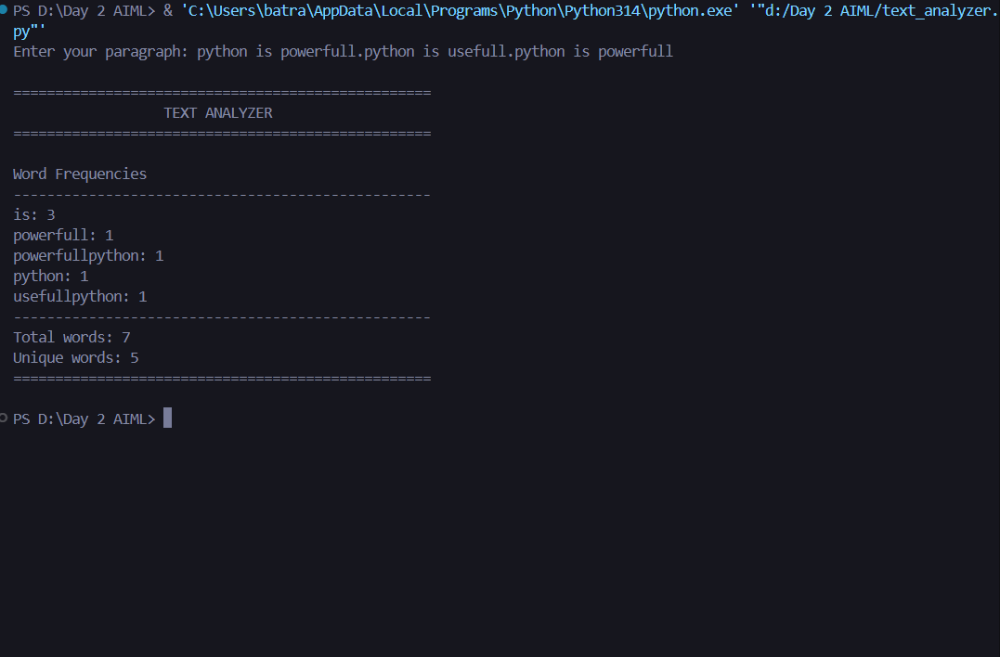
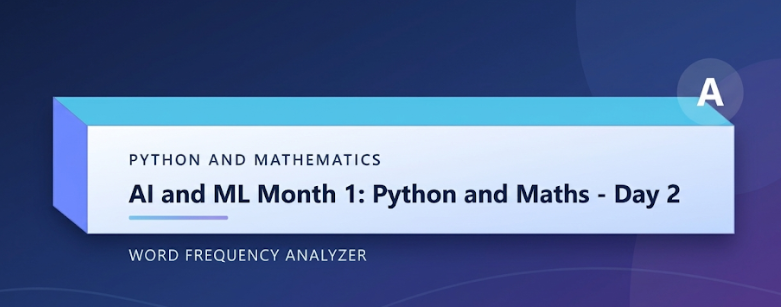

# Day-02-Word-Frequency-Analyzer

[](https://python.org)
[](https://github.com/chetanaybuilder/Ai-Ml-Month-01-Python-and-Maths)
[](https://github.com/chetanaybuilder/Ai-Ml-Month-01-Python-and-Maths)

A lightweight command-line Python utility that analyzes user-provided text and reports word frequencies, total word count, and unique word count. Built as part of the **AI & ML Month 1: Python and Maths** learning journey.

---

## 📸 Project Preview

<div align="center">

### Input Prompt


</div>

<div align="center">

### Analysis Output


</div>

<div align="center">

### Course Banner


</div>

> 📁 Place your banner image as `screenshots/banner.png` to display the course header.

---

## 🚀 Features

- ✅ Accepts a paragraph of text from the user
- ✅ Strips punctuation automatically
- ✅ Normalizes text to lowercase for uniform analysis
- ✅ Tokenizes input into individual words
- ✅ Counts frequency of each word
- ✅ Displays total word count and unique word count
- ✅ Clean terminal banner with section dividers
- ✅ Zero external dependencies — pure Python standard library

---

## 📂 Project Structure

```
Day-02-Word-Frequency-Analyzer/
├── text_analyzer.py   # Main analyzer script
├── README.md          # Project documentation
└── screenshots/       # Project preview images
    ├── screenshot-1.png
    ├── screenshot-2.png
    └── banner.png
```

---

## ⚡ Quick Start

### Prerequisites
- Python 3.x installed ([download here](https://python.org))

### Run the Analyzer

```bash
# Clone the repository
git clone https://github.com/chetanaybuilder/Ai-Ml-Month-01-Python-and-Maths.git

# Navigate to the Day 02 project folder
cd Ai-Ml-Month-01-Python-and-Maths/Day-02-Word-Frequency-Analyzer

# Run the script
python text_analyzer.py
```

### Example Session

```text
Enter your paragraph: Python is powerful. Python is useful. Python is powerful.

==================================================
                  TEXT ANALYZER                  
==================================================

Word Frequencies
--------------------------------------------------
python: 3
is: 3
powerful: 2
useful: 1
--------------------------------------------------
Total words: 7
Unique words: 4
==================================================
```

---

## 🛠️ How It Works

1. **Input Capture** — Reads a paragraph from the user via `input()`.
2. **Cleaning** — Removes all punctuation using `string.punctuation` and converts text to lowercase.
3. **Tokenization** — Splits the cleaned text into individual words.
4. **Frequency Counting** — Uses a dictionary to tally occurrences of each word.
5. **Reporting** — Prints sorted word frequencies, total count, and unique count inside a styled terminal banner.

---

## 📜 Requirements

| Requirement | Version |
|-------------|---------|
| Python      | 3.x     |
| External libs | None (standard library only) |

---

## 🤝 Contributing

Contributions are welcome! Feel free to open issues or submit pull requests to improve the analyzer.

1. Fork the repository
2. Create your feature branch (`git checkout -b feature/improvement`)
3. Commit your changes (`git commit -m 'Add some improvement'`)
4. Push to the branch (`git push origin feature/improvement`)
5. Open a Pull Request

---

## 👨‍💻 Author

**Chetanay Builder** — Future Founder  
AI & ML Enthusiast | Python Developer  
GitHub: [@chetanaybuilder](https://github.com/chetanaybuilder)

---

## 📄 License

This project is part of the **AI & ML Month 1: Python and Maths** series and is shared for educational purposes.

---

<p align="center">
  Made with ❤️ during <b>AI & ML Month 01</b> — Day 02
</p>