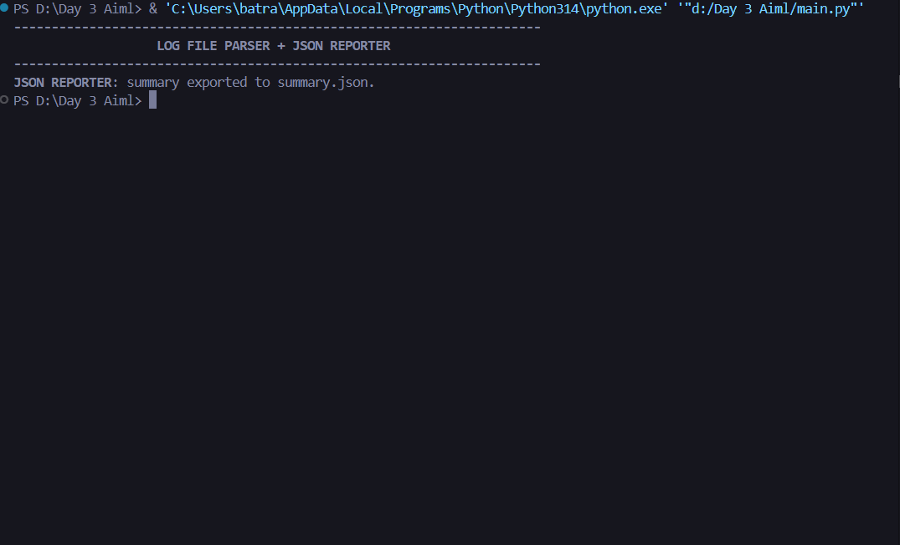
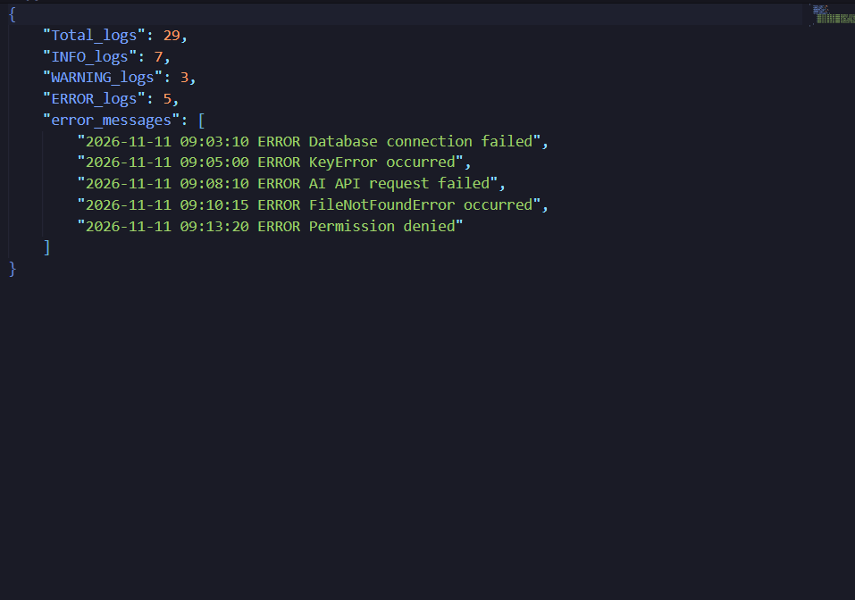

# 🔎 LOG FILE PARSER + JSON REPORTER


> A lightweight command-line utility that summarizes application log levels and exports the results as formatted JSON.

## ✨ Overview

This project reads `app.log`, counts `INFO`, `WARNING`, and `ERROR` entries, collects the complete error lines, and writes a readable report to `summary.json`. It uses only Python's standard library.

## 🚀 Features

- Counts `INFO`, `WARNING`, and `ERROR` log entries.
- Preserves each complete error line in the JSON report.
- Displays a project banner and a completion message in the terminal.
- Handles a missing `app.log` with a clear message.
- Produces an indented JSON file for easy review and downstream use.

## ⚙️ Requirements

- Python 3.6 or newer
- No third-party packages

## ▶️ Run the project

Open a terminal in this directory and run:

```bash
python main.py
```

On Windows, you can also use:

```powershell
py main.py
```

Keep `app.log` in the same directory and run the command from that directory. Each run replaces `summary.json` with a fresh report.

## 📁 Project structure

```text
Day-03-Log-file-parser-and-json-reporter/
├── app.log
├── main.py
├── summary.json
├── README.md
└── screenshots/
    ├── terminal-run.png
    └── json-summary.png
```

## 📊 Sample report

The included log produces these counts:

| Log level | Entries |
|:--|--:|
| INFO | 7 |
| WARNING | 3 |
| ERROR | 5 |

The report also contains the five error messages. `Total_logs` represents physical lines in the input file, including blank lines; therefore the included file reports 29 total lines.

## 🧭 Processing flow

```text
app.log → classify log levels → collect error lines → summary.json
```

## 🖼️ Screenshots

### Terminal execution



### Generated JSON summary


