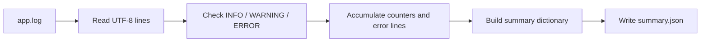

<p align="center">
  
</p>

<h1 align="center">Log File Parser and JSON Reporter</h1>

<p align="center">
  A standard-library utility that counts selected log markers and exports a structured JSON summary.
</p>

<p align="center">
  
  
  
</p>

<p align="center">
  <a href="#overview">Overview</a> ·
  <a href="#what-i-learned">Learning</a> ·
  <a href="#setup-and-run">Run</a> ·
  <a href="#engineering-takeaways">Takeaways</a>
</p>

---

## Overview

[`main.py`](main.py) reads `app.log` from the current working directory, classifies lines containing `INFO`, `WARNING`, or `ERROR`, collects error lines, and writes the counts and messages to `summary.json`.

## What I Learned

### Learning Progress

**Day 03 — File Processing and Structured Data**

This project moves from in-memory string processing to reading a line-oriented file, aggregating records, and serializing the result as JSON.

### What I Built

I implemented a log summarizer that:

- Reads UTF-8 input with a context manager.
- Counts log-level markers in one pass over the lines.
- Retains full lines classified as errors.
- Writes an indented JSON report with `json.dump()`.
- Prints a user-facing message when `app.log` is missing.

### Engineering Takeaways

1. Context managers make file-handle lifetime explicit and reliable.
2. A single pass is sufficient for these simple counters and collected messages.
3. JSON provides a portable, inspectable representation for aggregated data.
4. Define what a “total record” means: this program counts physical lines, including blank lines.

## Features

| Input | Processing | Output |
|---|---|---|
| `app.log` in the working directory | Substring checks for `INFO`, `WARNING`, `ERROR` | `summary.json` |
| UTF-8 text | One category per line through an `if`/`elif` chain | Counts and full error lines |

## Architecture



## Project Structure

```text
Day-03-Log-file-parser-and-json-reporter/
├── app.log
├── main.py
├── README.md
└── summary.json
```

## Setup and Run

Requirements: Python 3.6 or later. The script uses only the standard library.

Run from this project directory; the script uses paths relative to the current working directory:

```console
python main.py
```

On Windows, `py main.py` also works if the Python launcher is installed.

## Verified Sample Results

The included `app.log` has **29 physical lines**, including blank lines. Its checked-in report contains:

| Field | Value |
|---|---:|
| `Total_logs` | 29 |
| `INFO_logs` | 7 |
| `WARNING_logs` | 3 |
| `ERROR_logs` | 5 |

The output also includes the five full lines classified as errors.

## Implementation Details and Limitations

Classification uses substring matching rather than parsing a formal log schema. Because it uses `if`/`elif`, a line containing more than one marker is counted in the first matching category. `Total_logs` counts every physical line returned by `readlines()`, not only non-empty or recognized records.

The script handles `FileNotFoundError`; other file errors are not explicitly caught. A successful run replaces the existing `summary.json`.

## Testing

No automated test files are included in this project.

## Future Improvements

- Resolve paths relative to `main.py` rather than the shell's current directory.
- Parse structured levels instead of matching arbitrary substrings.
- Add tests for empty input, missing files, and lines with multiple markers.

## Project Information

Part of the **AI/ML Month 1 — Python and Core Mathematics** learning series.

Author: [chetanaybuilder](https://github.com/chetanaybuilder)
