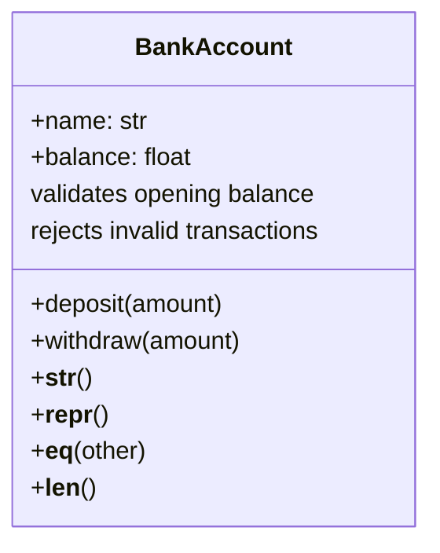

<p align="center">
  
</p>

<h1 align="center">Bank Account Management with OOP</h1>

<p align="center">
  A small in-memory model demonstrating class design, transaction validation, and Python special methods.
</p>

<p align="center">
  
  
  
</p>

<p align="center">
  <a href="#overview">Overview</a> ·
  <a href="#what-i-learned">Learning</a> ·
  <a href="#setup-and-run">Run</a> ·
  <a href="#engineering-takeaways">Takeaways</a>
</p>

---

## Overview

[`main.py`](main.py) defines a `BankAccount` class with a holder name and balance, then runs a fixed demonstration with two sample accounts. The project is an educational example; it does not persist accounts or implement real banking controls.

## What I Learned

### Learning Progress

**Day 04 — Object-Oriented Programming**

This project applies classes and instance state to a concrete domain example. It also explores how special methods connect custom objects to Python's built-in operations and representations.

### What I Built

I implemented the `BankAccount` class with:

- An initializer that rejects negative opening balances.
- `deposit()` and `withdraw()` methods with transaction validation.
- `__str__` and `__repr__` for display and debugging.
- `__eq__` to compare account-holder names and `__len__` to return the holder-name length.

The entry point demonstrates a deposit followed by a withdrawal and prints the updated balance.

### Engineering Takeaways

1. Put state-changing rules close to the state they protect.
2. Special methods should have clear, documented semantics; here equality means same holder name, not identical account state.
3. Raise a specific exception when an operation violates an invariant.
4. Use this example as a learning model, not as a financial implementation.

## Features

| Method or behavior | Contract |
|---|---|
| `BankAccount(name, balance)` | Rejects an initial balance below zero |
| `deposit(amount)` | Requires a positive amount |
| `withdraw(amount)` | Requires a positive amount no greater than the balance |
| `str(account)` | Displays the holder and formatted balance |
| `account_a == account_b` | Compares holder names |
| `len(account)` | Returns the number of characters in the holder name |

## Object Model



## Project Structure

```text
Day-04-Bank-Account-Management-OOP/
├── main.py
└── README.md
```

## Setup and Run

Requirements: Python 3.6 or later. No package installation is required.

```console
python main.py
```

Run the command from this project directory. On Windows, `py main.py` also works if the Python launcher is installed.

## Reuse the Class

```python
from main import BankAccount

account = BankAccount("Alex", 5000.0)
account.deposit(250.0)
account.withdraw(100.0)
print(account)
```

## Verified Demonstration

The fixed example starts Alex at `$5,000.00`, deposits `$500.00`, and withdraws `$200.00`. The displayed final balance is `$5,300.00`.

## Error Handling and Limitations

Invalid opening balances and transaction amounts raise `ValueError`; withdrawing more than the current balance also raises `ValueError`. Balances are stored in memory as floating-point numbers, which are not a suitable default for precise financial arithmetic. There is no persistence, authentication, transaction history, or concurrency handling.

## Testing

No automated test files are included in this project.

## Future Improvements

- Add unit tests for normal transactions and every validation condition.
- Use `decimal.Decimal` for monetary values.
- Separate the reusable class from the demonstration in `main.py`.

## Project Information

Part of the **AI/ML Month 1 — Python and Core Mathematics** learning series.

Author: [chetanaybuilder](https://github.com/chetanaybuilder)
