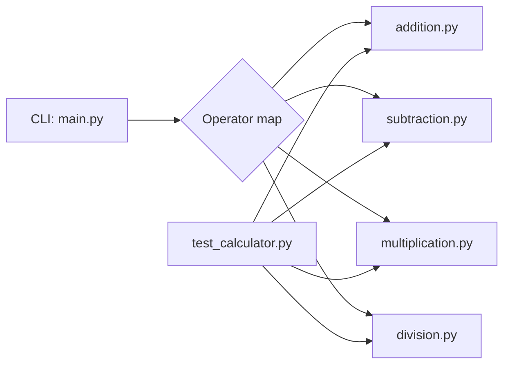

<p align="center">
  
</p>

<h1 align="center">Calculator: Modules, Packages, and Testing</h1>

<p align="center">
  An interactive calculator organized as reusable operation modules and verified with pytest.
</p>

<p align="center">
  
  
  
</p>

<p align="center">
  <a href="#overview">Overview</a> ·
  <a href="#what-i-learned">Learning</a> ·
  <a href="#setup-and-run">Run</a> ·
  <a href="#engineering-takeaways">Takeaways</a>
</p>

---

## Overview

The `calculator` package separates addition, subtraction, multiplication, and division into individual modules. [`main.py`](main.py) maps operator symbols to those functions and provides an interactive terminal loop. [`tests/test_calculator.py`](tests/test_calculator.py) verifies the arithmetic behavior.

## What I Learned

### Learning Progress

**Day 05 — Modules, Packages, and Automated Testing**

This project applies code organization and test isolation: operation logic is reusable outside the CLI, while tests exercise functions directly rather than simulating terminal input.

### What I Built

I implemented:

- Four arithmetic functions in the `calculator` package.
- An interactive CLI that dispatches `+`, `-`, `*`, or `/` to the corresponding function.
- Input conversion and user-facing handling for invalid operators, non-numeric values, and division by zero.
- Pytest coverage for four representative operation results and a division-by-zero exception.

### Engineering Takeaways

1. Separate core operations from the presentation layer so each can be reused and tested independently.
2. A mapping from operator symbols to functions avoids a long conditional dispatch chain.
3. Test expected behavior and important exceptions, not just successful startup.
4. Handle user-input errors at the CLI boundary while keeping arithmetic functions simple.

## Features

| Operation | Symbol | Implementation module |
|---|:---:|---|
| Addition | `+` | `calculator/addition.py` |
| Subtraction | `-` | `calculator/subtraction.py` |
| Multiplication | `*` | `calculator/multiplication.py` |
| Division | `/` | `calculator/division.py` |

## Architecture



## Project Structure

```text
Day-05-Python-Modules-Packages-Testing/
├── calculator/
│   ├── __init__.py
│   ├── addition.py
│   ├── division.py
│   ├── multiplication.py
│   └── subtraction.py
├── tests/
│   └── test_calculator.py
├── main.py
├── README.md
└── requirements-dev.txt
```

## Setup and Run

Requires Python 3.10 or later, as specified by this project, and pytest for tests. Create a virtual environment and install the listed development dependency:

```powershell
python -m venv .venv
.\.venv\Scripts\Activate.ps1
python -m pip install -r requirements-dev.txt
```

On macOS or Linux, activate with:

```sh
source .venv/bin/activate
```

Start the calculator from this project directory:

```console
python main.py
```

## Usage

Choose an operator, enter two numbers, and repeat as needed. Enter `q` at the operator prompt to exit. The operation modules can also be imported directly:

```python
from calculator.division import division

print(division(20, 10))
```

## Error Handling and Limitations

The CLI rejects unknown operators before prompting for operands. It catches `ValueError` during float conversion and `ZeroDivisionError` during division. The arithmetic functions do not validate operand types and use standard Python numeric behavior; results use floating-point arithmetic because the CLI converts inputs with `float()`.

## Testing

Run the checked-in pytest suite from this project directory:

```console
python -m pytest
```

The suite contains a parameterized test for four arithmetic results and a test asserting division by zero raises `ZeroDivisionError`.

## Future Improvements

- Add CLI tests for invalid operators and non-numeric values.
- Document precision expectations or add support for `decimal.Decimal`.
- Add type annotations to the operation functions.

## Project Information

Part of the **AI/ML Month 1 — Python and Core Mathematics** learning series.

Author: [chetanaybuilder](https://github.com/chetanaybuilder)
