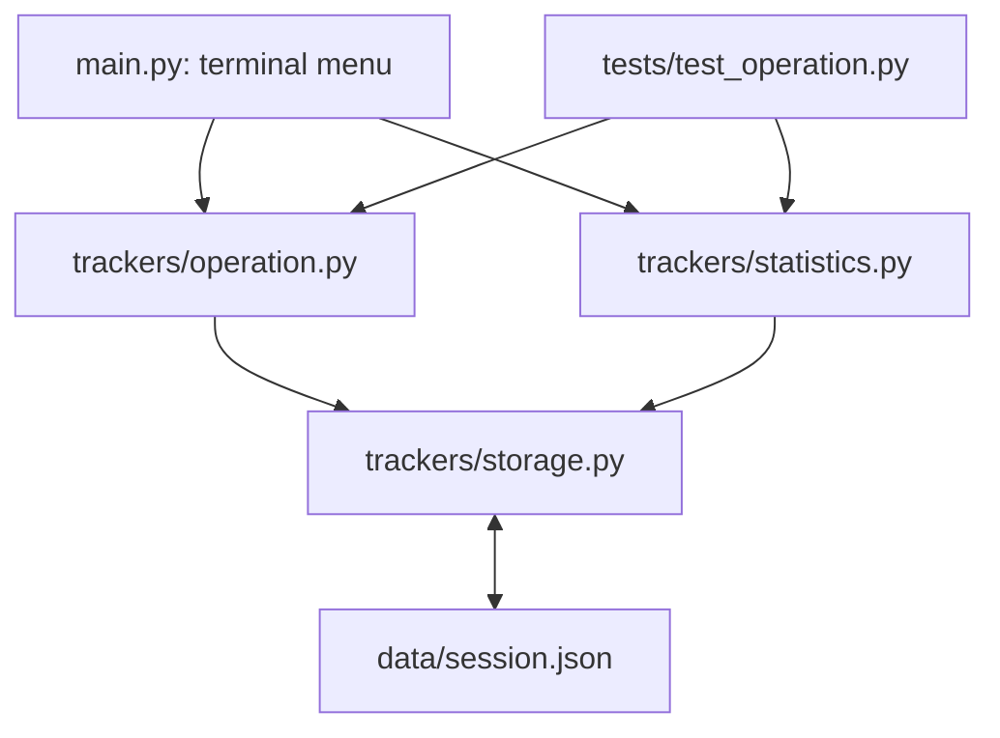

<p align="center">
  
</p>

<h1 align="center">Study Tracker</h1>

<p align="center">
  A terminal application for recording study sessions and summarizing study time by subject.
</p>

<p align="center">
  
  
  
</p>

<p align="center">
  <a href="#overview">Overview</a> ·
  <a href="#what-i-learned">Learning</a> ·
  <a href="#setup-and-run">Run</a> ·
  <a href="#engineering-takeaways">Takeaways</a>
</p>

---

## Overview

The Study Tracker provides a menu to add study sessions, list saved records, and view summary statistics. It stores records in `data/session.json`; its modules separate the terminal interface, operations, statistics, and file storage.

## What I Learned

### Learning Progress

**Week 01 Project — Applying Month 01 Python Fundamentals**

This project combines the month's foundations in a small multi-module application: functions, input handling, dictionaries, JSON serialization, file paths, and tests around file-backed behavior.

### What I Built

I implemented a menu-driven tracker that:

- Accepts subject, chapter, date text, and integer duration for a session.
- Adds and lists session dictionaries stored in JSON.
- Calculates session count, total minutes, and totals by subject.
- Uses temporary files and patched paths in tests to avoid changing the real data file.

`main.py` presents the menu; `trackers/operation.py` manages records; `trackers/statistics.py` aggregates values; and `trackers/storage.py` handles JSON persistence.

### Engineering Takeaways

1. Small modules with focused responsibilities make behavior easier to understand and test.
2. Use temporary files when testing persistence to isolate tests from user data.
3. Resolve application data paths consistently so execution location does not change storage location.
4. Treat data validation and storage failures as explicit product decisions, not incidental details.

## Features

| Area | Behavior |
|---|---|
| Add session | Stores subject, chapter, date string, and integer duration |
| View sessions | Displays saved records |
| Statistics | Reports number of sessions, total minutes, and minutes by subject |
| Persistence | JSON file at `data/session.json` |
| Tests | Add, retrieve, and statistics behavior |

## Architecture



## Project Structure

```text
Day-06-weekly-project/
├── data/
│   └── session.json
├── tests/
│   ├── __init__.py
│   └── test_operation.py
├── trackers/
│   ├── __init__.py
│   ├── operation.py
│   ├── statistics.py
│   └── storage.py
├── .gitignore
├── main.py
├── README.md
└── requirements.txt
```

## Setup and Run

Requires Python 3.10 or later, as specified by this project. Create and activate a virtual environment, then install the dependency listed in `requirements.txt`:

```powershell
python -m venv .venv
.\.venv\Scripts\Activate.ps1
python -m pip install -r requirements.txt
```

On macOS or Linux, activate with:

```sh
source .venv/bin/activate
```

Run from this project directory:

```console
python main.py
```

Select `1` to add a session, `2` to list sessions, `3` for statistics, or `4` to exit.

## Data and Implementation Notes

The storage module resolves the JSON file relative to the project root. Each saved record contains `subject`, `date`, `duration`, and `chapter`. Statistics convert the stored duration to an integer and sum durations by subject.

The date prompt asks for `YYYY-MM-DD`, but the application stores the provided string without validating the format. Duration input must parse as an integer, but zero and negative values are currently accepted.

## Error Handling and Limitations

The storage loader returns an empty list if the file is absent, empty, malformed, unreadable, or contains a JSON value other than a list. Consequently, a data problem can appear as an empty tracker. Save errors are not caught by the storage layer.

## Testing

Run the existing standard-library tests from this project directory:

```console
python -m unittest discover -s tests -v
```

The tests cover adding, reading, and summarizing records using temporary files and patched storage paths. `requirements.txt` lists pytest, but the checked-in tests use `unittest`.

## Future Improvements

- Validate dates and require positive study durations.
- Surface invalid or unreadable JSON instead of treating it as an empty session list.
- Add tests for invalid input, storage failures, and edge cases.
- Add export or backup support for saved sessions.

## Project Information

Part of the **AI/ML Month 1 — Python and Core Mathematics** learning series.

Author: [chetanaybuilder](https://github.com/chetanaybuilder)
