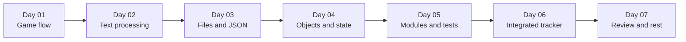

  

<h1 align="center">Day 07 — Rest, Review, and Consolidation</h1>

  A deliberate pause to revisit the first week, connect the concepts, and prepare for the next stage.

  
  
  

  <a href="#the-purpose-of-a-rest-day">Purpose</a> ·
  <a href="#week-01-learning-journey">Learning journey</a> ·
  <a href="#what-i-learned">What I learned</a> ·
  <a href="#next-steps">Next steps</a>

---

## The Purpose of a Rest Day

Day 07 marks the end of the first week of Month 01. This entry is for review and reflection—not a new application or a claim of additional implementation. Taking time to consolidate the week's work helps turn separate exercises into a clearer understanding of how Python programs are structured, executed, and tested.

## Week 01 Learning Journey

| Day | Project | What I built | Concepts applied |
|---|---|---|---|
| 01 | [Number Guessing Game](../Day-01-Number-guessing-game/README.md) | A terminal game with a random target, five valid guesses, range checks, and high/low feedback. | Functions, random integers, input conversion, `try`/`except`, loops, conditionals, counters. |
| 02 | [Word Frequency Analyzer](../Day-02-Word-Frequency-Analyzer/README.md) | A script that normalizes a paragraph, counts words, and prints an alphabetical frequency report. | String translation, lowercase normalization, whitespace tokenization, dictionary accumulation, sorting. |
| 03 | [Log File Parser and JSON Reporter](../Day-03-Log-file-parser-and-json-reporter/README.md) | A script that counts selected log markers and writes a JSON summary with error lines. | File handling, context managers, line iteration, aggregation, JSON serialization, targeted exception handling. |
| 04 | [Bank Account Management with OOP](../Day-04-Bank-Account-Management-OOP/README.md) | An in-memory `BankAccount` class with validated deposits and withdrawals and a runnable demonstration. | Classes, instance state, methods, validation, exceptions, special methods. |
| 05 | [Calculator: Modules, Packages, and Testing](../Day-05-Python-Modules-Packages-Testing/README.md) | A four-operation calculator with separate operation modules and pytest coverage. | Packages, imports, function dispatch, CLI error handling, parameterized tests. |
| 06 | [Study Tracker](../Day-06-weekly-project/README.md) | A menu-driven application for recording sessions in JSON and summarizing study time. | Modular design, `pathlib`, JSON persistence, dictionaries, aggregation, `unittest`, temporary files. |
| 07 | **Rest, review, and consolidation** | No new application was built for this day. | Reflection, revisiting prior implementation decisions, identifying next learning goals. |

## What I Learned

### Programming Concepts

- **Control flow:** Input, conditions, and loops form the behavior of interactive programs.
- **Data transformation:** Strings can be normalized and tokenized before values are counted or compared.
- **Persistence:** Files let a small script retain structured data between runs; JSON provides a human-readable format.
- **State and behavior:** Classes group related data with operations that change or inspect it.
- **Modularity:** Splitting code by responsibility makes functions easier to reuse and reason about.
- **Testing:** Tests can check both expected results and failure behavior; temporary files help isolate persistence tests.

### Engineering Habits

- Validate input at boundaries, and be explicit about what is and is not validated.
- Keep implementation descriptions aligned with behavior in the source.
- Choose storage and error-handling behavior deliberately; a silent fallback can hide a problem.
- Use examples and tests to make expected behavior observable.
- Build incrementally, then review how the pieces fit together.

## What I Built

Across Days 01–06, I independently implemented six small Python projects that progress from a single-file interactive game to a multi-module, file-backed application. Together, they exercise terminal input/output, text processing, log aggregation, object-oriented state, reusable packages, JSON persistence, and automated tests.

**Day 07 itself is a review milestone.** This README records the learning progression and links back to each project's documentation; it does not introduce new application functionality.

## Engineering Takeaways

1. A useful progression is to make behavior work first, then separate responsibilities and test the important contracts.
2. Input validation, storage behavior, and error handling are part of an application's interface—not details to leave implicit.
3. Modules and tests improve maintainability even when a project is small.
4. A portfolio is more credible when it documents real limitations alongside implemented features.

## Review Checklist

- Re-run each project's documented commands and tests when changing its code.
- Revisit edge cases: invalid input, empty files, malformed JSON, and invalid transactions.
- Review which improvements would make the largest difference before adding more features.
- Keep notes about questions to investigate in the next learning week.

## Next Steps

The next stage of the learning journey can build on these foundations with further Python practice and core mathematics. No future feature or topic is presented here as already implemented.

## Project Information

Part of the **AI/ML Month 1 — Python and Core Mathematics** learning series.

Author: [chetanaybuilder](https://github.com/chetanaybuilder)
